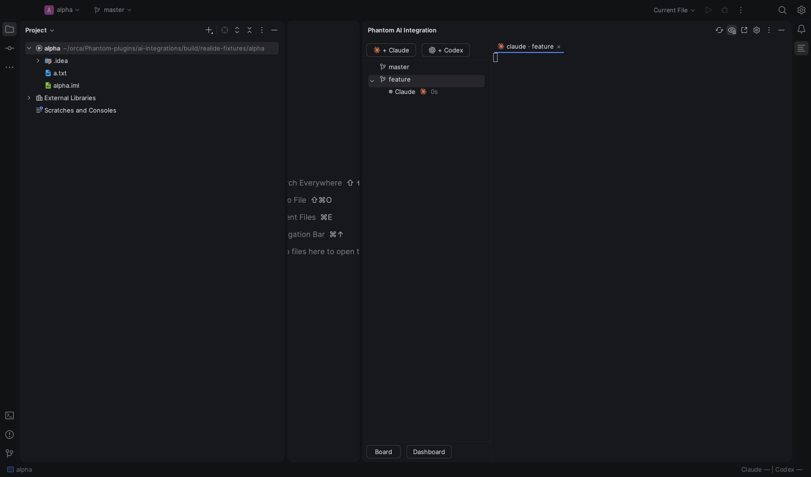
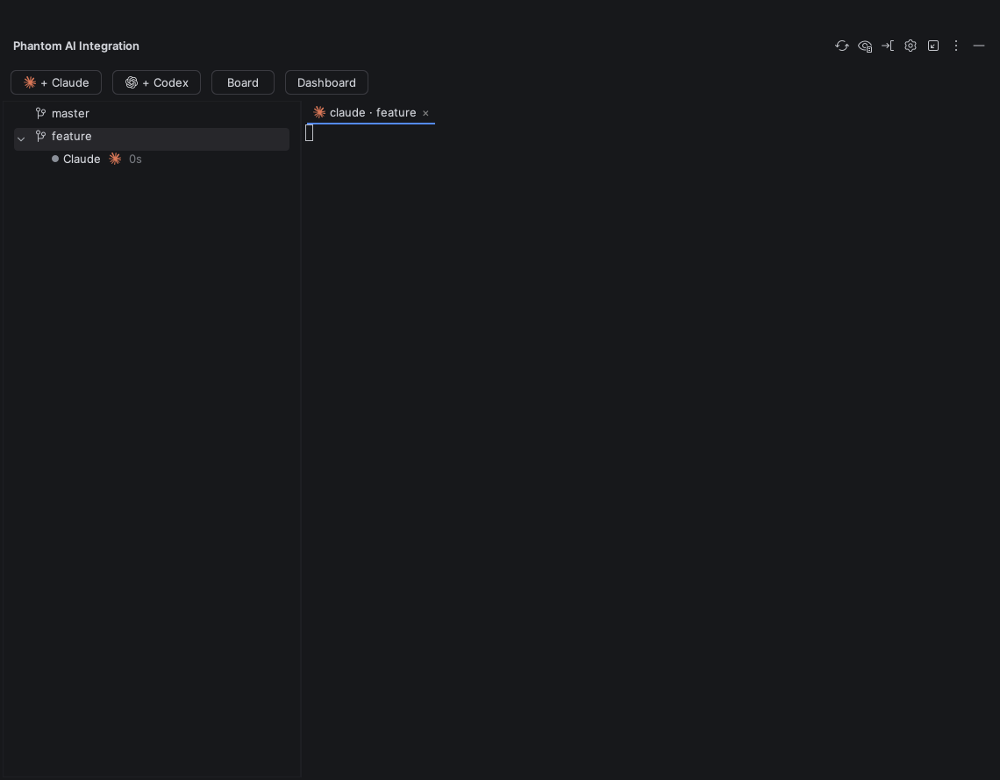
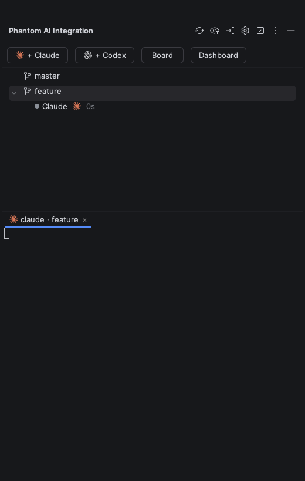

# Phantom AI Integration

`dev.phantom.ai` · [English](./README.md)

프로젝트 옆에서 쓰는 Claude Code와 Codex입니다. Phantom Workspaces(`dev.phantom.workspaces`)가 필요합니다.

 

- **도구 창:** Phantom AI Integration 도구 창은 현재 프로젝트의 패널 하나입니다. 프로젝트의 저장소, worktree, 에이전트 세션 트리(GitHub 플러그인에 그 원격의 계정이 있으면 열린 PR 제목도)가 에이전트 터미널과 나란히 있고, 터미널은 닫을 수 있는 탭으로 하나씩 열립니다. 도킹하면 트리는 항상 터미널 왼쪽에 있고, 플로팅이나 창 모드에서는 너비가 `max(600, 0.8 × 높이)` 이상이면 왼쪽, 아니면 위에 놓이며, 제목줄의 Hide Tree / Show Tree로 트리를 접습니다. 도킹했을 때 + Claude, + Codex, Board, Dashboard는 트리 쪽에 있고, 플로팅이거나 트리를 접으면 전체 너비 한 줄에 놓입니다. 플로팅 창은 크기와 위치를 기억합니다. 프로젝트 그룹과 Add Repo는 없습니다. 저장소는 현재 프로젝트의 것입니다.
- **세션:** New Claude Session, New Codex Session, Resume Session은 worktree에서 `claude`나 `codex`를 이 도구 창의 터미널 탭으로 띄웁니다. 세션은 작업 중, 입력 대기, 완료로 표시되고 읽지 않음 표시가 붙습니다.
- **에이전트가 편집기를 다룸:** 에이전트 터미널은 설정 없이 Phantom 전용 MCP 서버(`phantom`, 루프백 훅 서버, 실행마다 새 토큰)에 연결됩니다. "그거 어디야?"라고 물으면 에이전트가 그 파일을 해당 줄에서 편집기로 열고, 블록을 선택하고, 창을 앞으로 가져옵니다(`open_in_editor`). worktree가 열려 있지 않으면 프로젝트 탭으로 엽니다. "이거"라고 하면 지금 보고 있는 파일, 커서 위치, 선택 영역을 읽습니다(`get_editor_context`).
- **보드:** Board(버튼 또는 Find Action의 Open Board)가 에디터 탭을 열고, 모든 worktree를 카드로 열(Todo, In progress, In review, Done)에 보여 주고, 카드를 끌어 옮깁니다. 카드에는 브랜치, 세션 상태 점, 프롬프트가 나옵니다.
- **대시보드:** Open Agent Dashboard(Find Action)가 별도 창을 엽니다. 세션을 Needs attention, Working, Done으로 나누고 마지막 프롬프트와 답, 서브에이전트, 검색, 에이전트/프로젝트 필터를 보여 줍니다. 세션을 누르면 그 터미널로 갑니다.
- **상태 표시줄:** 사용량 위젯이 Claude의 `5h`, `wk`(와 Fable), Codex의 `5h`, `wk`를 보여 주고, 초기화 시각은 툴팁에 나옵니다.
- **원격 제어:** 기본은 꺼져 있습니다. Settings | Tools | Phantom AI Integration | Remote Control에서 고른 주소와 포트(이 컴퓨터, Tailscale, 로컬 네트워크 주소)로 작은 웹 서버를 시작합니다. Generate link가 페어링 링크와 QR 코드를 만들고, 다른 기기의 브라우저에서 열면 worktree와 세션 목록, 에이전트 터미널 화면을 보고 입력할 수 있고, 목록에 있는 worktree에서 Claude나 Codex를 시작하거나 이어갈 수 있습니다.
- **계정:** Settings | Tools | Phantom AI Integration에 에이전트별로 System default와 추가한 계정이 나옵니다. 계정을 추가하면 전용 설정 폴더(`CLAUDE_CONFIG_DIR` 또는 `CODEX_HOME`)를 만들고, 거기에 훅을 설치하고, CLI 로그인을 터미널로 엽니다. 활성으로 표시한 계정이 새 터미널에 쓰입니다. 토큰은 Phantom이 저장하지 않고 CLI가 로그인을 관리합니다.

## 공개 API

`dev.phantom.ai.api`가 이 플러그인의 공개 API이며 다른 플러그인이 쓸 수 있는 유일한 패키지입니다. `dev.phantom.ai.*`의 나머지는 내부 구현이라 바뀔 수 있습니다. `plugin.xml`에서 `dev.phantom.ai`에 의존하고 `PhantomAiApi.getInstance()`를 호출하세요.

- `sessions()` / `sessions(project)`: 변경할 수 없는 `AiSession`(탭 id, worktree 경로, 에이전트 `CLAUDE`/`CODEX`, 상태 `WORKING`/`WAITING`/`DONE`/`NONE`, 제목, `startedAt`). `NONE`은 시작했지만 아직 훅 이벤트가 없다는 뜻입니다.
- `AiSession.subagents`(0.3.1부터): 세션의 Claude가 Task 도구나 에이전트 팀으로 띄운 서브에이전트마다 `AiSubagent`(id, `Explore`·`Plan` 같은 이름, `running`)를 훅이 알린 대로 오래된 것부터 담습니다. `running`은 서브에이전트가 멈출 때까지 true입니다.
- `worktrees(project)`: `AiWorktree`(경로, 표시 제목, 브랜치, `prNumber`, `isMain`). 네트워크를 쓰지 않으므로 0.3.0에서 `prNumber`는 항상 null입니다.
- `addChangeListener(parent, listener)`: 세션과 이름이 바뀔 때, 그리고 리스너가 있는 동안 30초마다 확인해 worktree가 추가·삭제될 때 호출됩니다. `parent`가 dispose되면 제거됩니다.
- `focusSession(project, tabId)`, `startSession(project, worktreePath, agent)`: 세션의 터미널 탭을 선택하거나 새 Claude/Codex 세션을 시작합니다.

worktree를 나열하는 호출은 git을 실행하므로 EDT 밖에서 호출하세요.

## 쓰기 전에 읽어 주세요

- **권한 확인은 항상 건너뜁니다.** 끄는 설정은 없습니다. 모든 터미널이 `claude --dangerously-skip-permissions` 또는 `codex --dangerously-bypass-approvals-and-sandbox`로 실행됩니다(이어가기: `claude --dangerously-skip-permissions --resume <id>`, `codex resume --dangerously-bypass-approvals-and-sandbox <id>`). 에이전트가 묻지 않고 worktree에서 명령을 실행하고 파일을 고칠 수 있습니다.
- **원격 제어는 평문 HTTP입니다.** TLS가 없습니다. 같은 네트워크에서 페어링 링크를 본 사람은 권한 확인 없이 실행되는 에이전트를 조종할 수 있으므로 링크를 비밀번호처럼 다루세요. 32바이트 토큰은 SHA-256 해시로만 저장하고 Generate link가 새 토큰으로 바꿉니다(이미 붙은 브라우저는 그때까지 동작). 서버는 꺼져 있고, 다른 주소를 고르지 않으면 `127.0.0.1`에서만 받습니다. Tailscale이나 이 컴퓨터를 권합니다. 모든 경로와 웹소켓에 토큰이 필요하고(페어링 뒤에는 HttpOnly, SameSite=Strict 쿠키), 브라우저 화면은 xterm.js 6.0.0을 내장합니다.
- **훅은 IDE를 시작할 때 에이전트 설정에 기록됩니다.** System default와 모든 계정 폴더가 대상이며, Claude Code는 `~/.claude/settings.json`(이벤트별 훅), Codex는 `<CODEX_HOME>/hooks.json`(기본 `~/.codex/hooks.json`)입니다. 직접 만든 훅과 다른 키는 그대로 두고, 심볼릭 링크 파일은 링크와 권한을 유지하며, 올바른 JSON이 아닌 파일은 건드리지 않고 경고를 보여 줍니다. 훅은 로컬 서버(임의 포트, 토큰)로 이벤트를 보낼 뿐 컴퓨터 밖으로 데이터를 보내지 않습니다. Codex는 새 훅을 검토하고 신뢰할지 직접 묻습니다. `config.toml`에는 아무것도 쓰지 않습니다. 훅과 status line이 실행하는 스크립트는 `~/.phantom/ai`에 있습니다(0.3.7 이전에는 IDE 시스템 폴더에 있어 캐시를 지우면 동작하지 않았습니다). 옮긴 뒤 Codex가 훅 신뢰를 한 번 더 묻습니다.
- **Claude의 `statusLine`은 플러그인 스크립트를 거칩니다.** `settings.json`의 `statusLine`이 플러그인 스크립트(사용량 위젯에 데이터를 줍니다)로 바뀌므로 Phantom 밖에서 실행한 Claude에도 적용됩니다. 기존 status line 명령은 스크립트의 인자로 남아 같은 입력을 받고, 그 출력이 그대로 보입니다. 아무것도 출력하지 않을 때만 플러그인의 줄이 보입니다. 0.3.6부터이며, 이전 버전은 기존 값을 덮어썼습니다.
- **사용량은 인증 정보를 읽습니다.** macOS에서는 Claude OAuth 토큰을 `/usr/bin/security`로 키체인에서 읽고, 없으면 설정 폴더의 `.credentials.json`을 읽습니다. Codex 사용량은 `codex app-server`와 `auth.json`에서 가져옵니다. 각 제공사의 사용량 엔드포인트로만 보냅니다.

터미널 시작이나 훅 설치가 실패하면 로그에 남기고 알림으로 보여 줍니다. `-Dphantom.ai.claudeDir` / `-Dphantom.ai.codexDir`를 지정하면(실제 IDE 프로브가 지정합니다) System default가 어디서나 그 폴더가 됩니다: 훅 설치, 실행되는 에이전트의 `CLAUDE_CONFIG_DIR` / `CODEX_HOME`, 자격 증명(그 폴더의 `.credentials.json`, 키체인은 그 폴더의 접미사 붙은 서비스 이름으로 조회), Codex 사용량, 세션 조회. 지정하지 않으면 System default는 환경 변수를 설정하지 않고 `~/.claude` / `~/.codex`를 씁니다. 프로브는 `-Dphantom.ai.agentBinDir`(호출만 기록하는 `claude`/`codex` 스텁)과 `-Dphantom.ai.keychain=false`(키체인과 `/usr/bin/security`를 읽지 않음)도 지정합니다.
