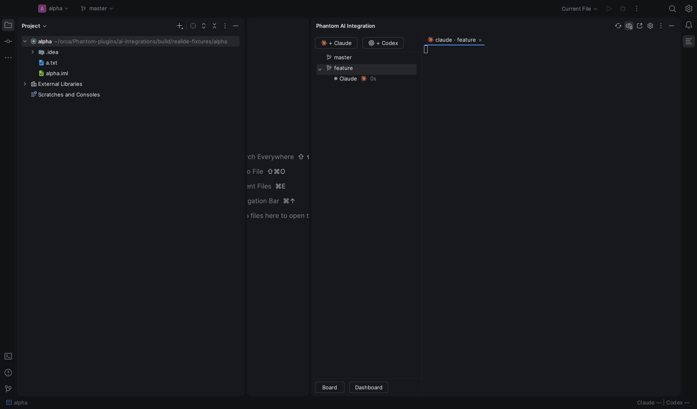
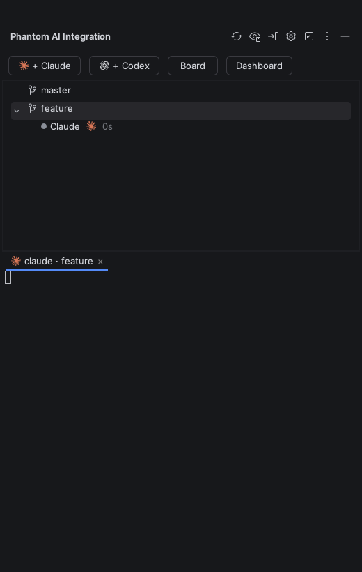

# Phantom AI Integration

`dev.phantom.ai` · [한국어](./KOR.md)

Claude Code and Codex next to your projects. Needs Phantom Workspaces (`dev.phantom.workspaces`).

 

- **Tool window:** the Phantom AI Integration tool window is one panel for the current project: a tree of the project's repositories, worktrees and their agent sessions (with the open pull request title when the GitHub plugin has an account for the remote) next to the agent terminals, each its own closable tab. A worktree made from a worktree row's New Worktree sits below that worktree, whatever its branch. A worktree row's "Send prompt here and below..." sends one prompt to that worktree and every one below it: typed into each one's open agent tabs, and a worktree with none starts Claude on it. Docked, the tree always sits left of the terminals; floating or windowed, it sits left when the window is at least as wide as `max(600, 0.8 × height)` and above them otherwise; the « at the top of the tree (or Hide Tree / Show Tree in the title bar) folds it into a thin Worktrees strip, and a click on the strip unfolds it. Docked, + Claude, + Codex, Board and Dashboard sit with the tree; floating (or with the tree hidden) they sit in a full-width row. A floating window keeps its size and position. There are no project groups and no Add Repo: the repositories are the current project's.
- **Sessions:** New Claude Session, New Codex Session and Resume Session start `claude` or `codex` in the worktree, in a terminal tab of that tool window. A session shows working, waiting for you or done, with an unread mark. Where tmux is installed each agent runs in its own tmux session: closing the project window leaves the agent running (the session tree in other windows keeps its status), reopening that window reattaches its tabs and clicking the session in the tree reattaches it in the current window; closing the tab, quitting Phantom or unloading the plugin ends it.
- **Agents control the editor:** every agent terminal connects its agent to Phantom's own MCP server (`phantom`, on the loopback hook server, per-run token), with no setup. Ask "where is that?" and the agent opens the file at the line in the editor, selects the block and brings the window to front (`open_in_editor`), opening the worktree as a project tab when it is not open yet; say "this" and it reads the file, caret and selection you are looking at (`get_editor_context`).
- **Agents search the IDE's index:** the same server answers code questions in short `path:line  code` lines, so an agent finds code without grepping and reading whole files: `find_symbol`, `find_file`, `find_usages` and `file_outline`; `get_symbol_info` (where a symbol is declared, its signature and doc comment) and `analyze_calls` (its callers, each with the member the call is in, and what it calls). `get_file_problems` gives a file's errors (and warnings if asked) from the IDE's analysis, after the agent's edits, without a build. `rename_refactoring` renames a symbol and its references with the IDE's Rename and saves the files; it changes nothing on a name conflict or when a reference lies outside the worktree. It covers the agent's own worktree, needs that worktree open in Phantom, and tells the agent to use its own search while indexing.
- **Agents read and edit by symbol:** `read_symbol` returns one class, method or field with its line numbers (`OrderService.save`) instead of the whole file; `replace_symbol` replaces a whole declaration and `insert_code` adds code before or after one, without the agent sending the old text. Each edit is one undoable command in the IDE, re-indented to its place, and saves the file. `get_run_output` gives the end of a Run, Debug or test console, filtered by a regular expression (`ERROR|Exception`), and whether the process still runs, so the agent reads the app's output itself.
- **Board:** Board (the button, or Open Board in Find Action) opens an editor tab that shows every worktree as a card in columns (Todo, In progress, In review, Done); drag a card to move it. A card carries its branch, session status dots and prompt.
- **Dashboard:** Open Agent Dashboard (Find Action) opens a separate window: sessions by Needs attention, Working and Done, with the last prompt and answer, subagents, search and agent/project filters. Click a session to jump to its terminal.
- **Status bar:** the usage widget shows Claude `5h` and `wk` (and Fable) and Codex `5h` and `wk`, with reset times in its tooltip. It looks while a Phantom window is active: Claude each minute unless a running session sent its usage on the status line, Codex every five minutes (each look starts `codex app-server`).
- **Remote Control:** off by default. Settings | Tools | Phantom AI Integration | Remote Control starts a small web server on the address and port you pick (this computer, your Tailscale or local-network address). Generate link makes a pairing link and QR code; open it in another device's browser to list worktrees and sessions, watch an agent terminal, type into it and start or resume Claude or Codex in a listed worktree.
- **AI memos:** select one or more lines in the editor (or click the gutter `+`, or use "AI 메모 추가" in the editor context menu, `Alt+Shift+N` / `⌥⇧N` on macOS) and type an AI command. The selected code and the memo show as one bordered block, like a pull-request review comment: blue while typing, yellow when saved, with the header `AI 메모 n/N · a–b줄` and edit and delete. `↩` saves, `⇧↩` adds a new line, `Esc` cancels, `⌘↩` saves and opens the send picker. Memos follow their code as lines move, are removed when their code is deleted, and are one-off: kept in memory only, gone when the IDE restarts or the project closes. The tool window lists the project window's memos (in file and line order, with checkboxes; click to jump), and "N개 한 번에 보내기" sits next to Board and Dashboard, so it is there with the tree folded too. Sending opens a picker of the worktree's sessions (status shown: working, waiting for you, done) plus a new Claude or Codex session; the default is the last-used session. The checked memos go as one prompt: "아래 코드 위치마다 요청을 처리해줘.", then numbered `path:line(s)`, the current code in a fence and `→ memo`. Files are saved first. A busy session (working, or waiting for an answer such as a permission prompt) is never interrupted: the prompt is queued, you are told, and it is sent when the session is done, one batch at a time. A queued batch shows as "대기 중 → session" in the list and can be cancelled (the memos come back); if the session closes, the memos come back too.
- **Accounts:** Settings | Tools | Phantom AI Integration lists the System default and any accounts you add, per agent. Adding one makes its own config dir (`CLAUDE_CONFIG_DIR` or `CODEX_HOME`), installs the hooks there and runs the CLI's login, which opens your browser; Phantom waits with a Cancel button. The account is named after the login's email. A denied, cancelled or timed-out login says why and keeps nothing, and an account already added is refused. An account whose login is gone cannot be selected until you Sign in again. An account shares your skills, plugins, memory, MCP servers, settings and conversation history with the System default through links; only the login differs. Remove deletes its folder, not what it links to. The one marked active is used by new terminals. Phantom stores no tokens; the CLI owns the login.

## Public API

`dev.phantom.ai.api` is the public API of this plugin and the only package other plugins may use; everything else in `dev.phantom.ai.*` is internal and may change. Depend on `dev.phantom.ai` in your `plugin.xml` and call `PhantomAiApi.getInstance()`:

- `sessions()` / `sessions(project)`: immutable `AiSession` views (tab id, worktree path, agent `CLAUDE`/`CODEX`, status `WORKING`/`WAITING`/`DONE`/`NONE`, title, `startedAt`). `NONE` means launched with no hook event yet.
- `AiSession.subagents` (since 0.3.1): `AiSubagent` (id, name such as `Explore` or `Plan`, `running`) for each subagent the session's Claude started with the Task tool or agent teams, oldest first, as its hooks report them; `running` stays true until the subagent stops.
- `worktrees(project)`: `AiWorktree` (path, display title, branch, `prNumber`, `isMain`). It never goes to the network, so `prNumber` is always null in 0.3.0.
- `addChangeListener(parent, listener)`: fires on session and name changes and, polled every 30 seconds while a listener exists, on worktrees added or removed. Removed when `parent` is disposed.
- `focusSession(project, tabId)` and `startSession(project, worktreePath, agent)`: select a session's terminal tab, or start a new Claude or Codex session.

Calls that list worktrees run git: call them off the EDT.

## Read before using

- **Permission checks are always skipped.** There is no setting. Every terminal runs `claude --dangerously-skip-permissions` or `codex --dangerously-bypass-approvals-and-sandbox` (resume: `claude --dangerously-skip-permissions --resume <id>`, `codex resume --dangerously-bypass-approvals-and-sandbox <id>`). The agent can run commands and edit files in the worktree without asking.
- **Remote Control is plain HTTP.** There is no TLS. Anyone on your network who sees the pairing link can drive your agents, which run without permission checks, so treat the link like a password. The 32-byte token is stored only as a SHA-256 hash and Generate link replaces it (paired browsers keep working until then). The server stays off, and listens on `127.0.0.1` unless you choose another address; prefer Tailscale or this computer. Every route and the websocket need the token (an HttpOnly, SameSite=Strict cookie after pairing); the browser UI uses xterm.js 6.0.0, bundled.
- **Hooks are written to your agent config at IDE start,** for the System default and every account dir: Claude Code's `~/.claude/settings.json` (hooks for its events) and Codex's `<CODEX_HOME>/hooks.json` (default `~/.codex/hooks.json`). Your own hooks and other keys stay; a symlinked file stays a symlink and keeps its permissions; a file that is not valid JSON is left alone and a warning is shown. The hooks post events to a local server (a random port, a token) and carry no data off the machine. Codex asks you to review and trust new hooks itself; nothing is written to its `config.toml`. The hook and status line scripts they run live in `~/.phantom/ai` (before 0.3.7 in the IDE's system dir, where clearing caches broke them); after the move Codex asks once more to trust its hooks.
- **The Claude `statusLine` runs through the plugin.** `statusLine` in `settings.json` becomes the plugin's script (it feeds the usage widget), so Claude started outside Phantom runs it too. A previous status line command is kept as the script's argument: it gets the same input and what it prints is shown; the plugin's own line shows only when it prints nothing. Since 0.3.6; earlier versions replaced it.
- **Usage reads credentials.** On macOS the Claude OAuth token is read from the keychain through `/usr/bin/security`, then `.credentials.json` in the config dir; Codex usage comes from `codex app-server` and its `auth.json`. They go only to the vendors' own usage endpoints.

Failures starting a terminal or installing hooks are logged and shown as a notification. With `-Dphantom.ai.claudeDir` / `-Dphantom.ai.codexDir` set (the real-IDE probe does), the System default is that dir everywhere: hook install, `CLAUDE_CONFIG_DIR` / `CODEX_HOME` of launched agents, credentials (`.credentials.json` there; the keychain is read with that dir's suffixed service name), Codex usage and session lookup. Without them the System default sets no environment variable and uses `~/.claude` / `~/.codex`. The probe also sets `-Dphantom.ai.agentBinDir` (stub `claude`/`codex` that only log their calls) and `-Dphantom.ai.keychain=false` (the keychain and `/usr/bin/security` are never read).
