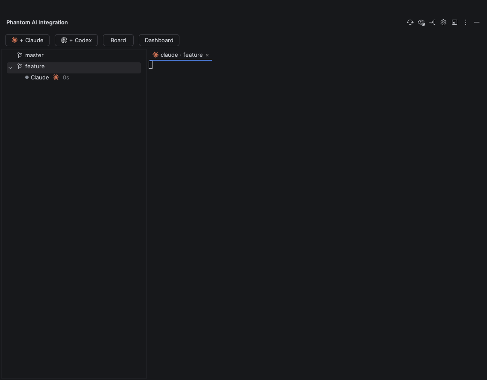

# Phantom AI Integration

`dev.phantom.ai` · [한국어](./KOR.md)

Claude Code and Codex next to your projects. Needs Phantom Workspaces (`dev.phantom.workspaces`).

 

- **Tool window:** the Phantom AI Integration tool window is one panel for the current project: a tree of the project's repositories, worktrees and their agent sessions (with the open pull request title when the GitHub plugin has an account for the remote) next to the agent terminals, each its own closable tab. Docked, the tree always sits left of the terminals; floating or windowed, it sits left when the window is at least as wide as `max(600, 0.8 × height)` and above them otherwise; Hide Tree / Show Tree in the title bar folds it away. Docked, + Claude, + Codex, Board and Dashboard sit with the tree; floating (or with the tree hidden) they sit in a full-width row. A floating window keeps its size and position. There are no project groups and no Add Repo: the repositories are the current project's.
- **Sessions:** New Claude Session, New Codex Session and Resume Session start `claude` or `codex` in the worktree, in a terminal tab of that tool window. A session shows working, waiting for you or done, with an unread mark.
- **Agents control the editor:** every agent terminal connects its agent to Phantom's own MCP server (`phantom`, on the loopback hook server, per-run token), with no setup. Ask "where is that?" and the agent opens the file at the line in the editor, selects the block and brings the window to front (`open_in_editor`), opening the worktree as a project tab when it is not open yet; say "this" and it reads the file, caret and selection you are looking at (`get_editor_context`).
- **Board:** Board (the button, or Open Board in Find Action) opens an editor tab that shows every worktree as a card in columns (Todo, In progress, In review, Done); drag a card to move it. A card carries its branch, session status dots and prompt.
- **Dashboard:** Open Agent Dashboard (Find Action) opens a separate window: sessions by Needs attention, Working and Done, with the last prompt and answer, subagents, search and agent/project filters. Click a session to jump to its terminal.
- **Status bar:** the usage widget shows Claude `5h` and `wk` (and Fable) and Codex `5h` and `wk`, with reset times in its tooltip.
- **Remote Control:** off by default. Settings | Tools | Phantom AI Integration | Remote Control starts a small web server on the address and port you pick (this computer, your Tailscale or local-network address). Generate link makes a pairing link and QR code; open it in another device's browser to list worktrees and sessions, watch an agent terminal, type into it and start or resume Claude or Codex in a listed worktree.
- **Accounts:** Settings | Tools | Phantom AI Integration lists the System default and any accounts you add, per agent. Adding one makes its own config dir (`CLAUDE_CONFIG_DIR` or `CODEX_HOME`), installs the hooks there and opens the CLI's login in a terminal. The one marked active is used by new terminals. Phantom stores no tokens; the CLI owns the login.

## Public API

`dev.phantom.ai.api` is the public API of this plugin and the only package other plugins may use; everything else in `dev.phantom.ai.*` is internal and may change. Depend on `dev.phantom.ai` in your `plugin.xml` and call `PhantomAiApi.getInstance()`:

- `sessions()` / `sessions(project)`: immutable `AiSession` views (tab id, worktree path, agent `CLAUDE`/`CODEX`, status `WORKING`/`WAITING`/`DONE`/`NONE`, title, `startedAt`). `NONE` means launched with no hook event yet.
- `AiSession.subagents` (since 0.3.1): `AiSubagent` (id, name such as `Explore` or `Plan`, `running`) for each subagent the session's Claude started with the Task tool or agent teams, oldest first, as its hooks report them; `running` stays true until the subagent stops.
- `worktrees(project)`: `AiWorktree` (path, display title, branch, `prNumber`, `isMain`). It never goes to the network, so `prNumber` is always null in 0.3.0.
- `addChangeListener(parent, listener)`: fires on session and name changes and, polled every 30 seconds while a listener exists, on worktrees added or removed. Removed when `parent` is disposed.
- `focusSession(project, tabId)` and `startSession(project, worktreePath, agent)`: select a session's terminal tab, or start a new Claude or Codex session.

Calls that list worktrees run git: call them off the EDT.

## Read before using

- **Permission checks are always skipped.** There is no setting. Every terminal runs `claude --dangerously-skip-permissions` or `codex --dangerously-bypass-approvals-and-sandbox` (resume: `claude --dangerously-skip-permissions --resume <id>`, `codex resume --dangerously-bypass-approvals-and-sandbox <id>`). The agent can run commands and edit files in the worktree without asking.
- **Remote Control is plain HTTP.** There is no TLS. Anyone on your network who sees the pairing link can drive your agents, which run without permission checks, so treat the link like a password. The 32-byte token is stored only as a SHA-256 hash and Generate link replaces it (paired browsers keep working until then). The server stays off, and listens on `127.0.0.1` unless you choose another address; prefer Tailscale or this computer. Every route and the websocket need the token (an HttpOnly, SameSite=Strict cookie after pairing); the browser UI uses xterm.js 6.0.0, bundled.
- **Hooks are written to your agent config at IDE start,** for the System default and every account dir: Claude Code's `~/.claude/settings.json` (hooks for its events) and Codex's `<CODEX_HOME>/hooks.json` (default `~/.codex/hooks.json`). Your own hooks and other keys stay; a symlinked file stays a symlink and keeps its permissions; a file that is not valid JSON is left alone and a warning is shown. The hooks post events to a local server (a random port, a token) and carry no data off the machine. Codex asks you to review and trust new hooks itself; nothing is written to its `config.toml`.
- **The Claude `statusLine` is taken over.** `statusLine` in `settings.json` is replaced by the plugin's script (it feeds the usage widget); a previous one is not backed up, so Claude started outside Phantom shows it too.
- **Usage reads credentials.** On macOS the Claude OAuth token is read from the keychain through `/usr/bin/security`, then `.credentials.json` in the config dir; Codex usage comes from `codex app-server` and its `auth.json`. They go only to the vendors' own usage endpoints.

Failures starting a terminal or installing hooks are logged and shown as a notification. With `-Dphantom.ai.claudeDir` / `-Dphantom.ai.codexDir` set (the real-IDE probe does), the System default is that dir everywhere: hook install, `CLAUDE_CONFIG_DIR` / `CODEX_HOME` of launched agents, credentials (`.credentials.json` there; the keychain is read with that dir's suffixed service name), Codex usage and session lookup. Without them the System default sets no environment variable and uses `~/.claude` / `~/.codex`. The probe also sets `-Dphantom.ai.agentBinDir` (stub `claude`/`codex` that only log their calls) and `-Dphantom.ai.keychain=false` (the keychain and `/usr/bin/security` are never read).
