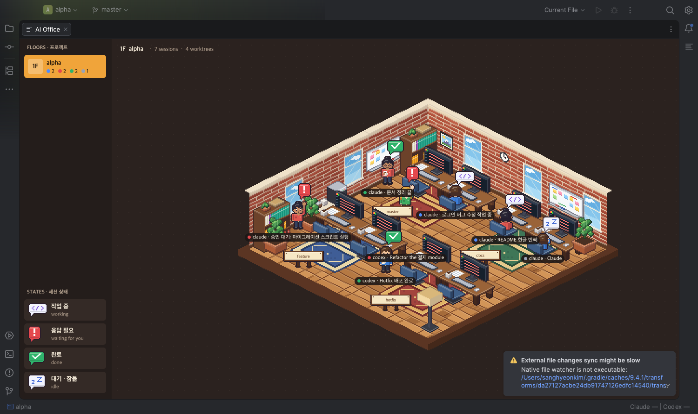

# Phantom AI Visualization

`dev.phantom.ai.visualization` · [English](./README.md)

Phantom AI Integration의 에이전트 세션을 아이소메트릭 픽셀 아트 사무실로 보여 줍니다. Phantom AI Integration 0.3.0 이상(`dev.phantom.ai`)이 필요하며, 그 공개 API `dev.phantom.ai.api`만 씁니다.




- **사무실:** Tools | Open AI Office(또는 Find Action의 Open AI Office)가 현재 프로젝트의 "AI Office" 에디터 탭을 엽니다. 열린 프로젝트마다 한 층, worktree마다 러그와 이름표가 있는 책상 구역 하나, 실행 중인 에이전트 세션마다 책상에 앉은 사람 한 명입니다. 한 worktree에 세션이 여럿이면 그 구역에 사람이 여럿입니다. 실행 중이 아닌 저장된 세션은 그리지 않습니다. 층 선택기는 위층부터 나열하고 상태별 세션 수를 보여 줍니다. 처음 열린 프로젝트가 1F이고, 열 때 현재 프로젝트의 층이 선택됩니다. 한 층에 worktree가 6개를 넘으면 한 쪽에 책상 구역 6개씩 나눕니다.
- **상태:** 작업 중은 책상에서 타이핑하는 사람, 입력 대기는 손을 들고 서 있는 사람과 `!` 말풍선, 완료는 커피를 든 사람과 체크 말풍선, 아직 훅 이벤트가 없는 세션은 자는 사람과 `zzz` 말풍선입니다.
- **조작:** 사람을 누르면 그 세션의 터미널 탭으로 가고, 빈 책상을 누르면 그 worktree에서 New Claude / New Codex를 고릅니다. Ctrl+휠은 정수 단계(1~6)로 확대·축소하고, 끌면 이동합니다. 사람 위에 마우스를 올리면 제목, 에이전트, 경과 시간이 나옵니다. 애니메이션(타이핑, 말풍선 흔들림)은 탭이 보일 때만 돕니다.
- **표현:** 스프라이트는 2:1 아이소 격자에서 뒤에서 앞으로 깊이순으로, 최근접 정수 배율로 그립니다. 글자는 확대한 뒤 화면 해상도로 또렷하게 그리며 한글도 나옵니다.
- **테마:** Settings | Tools | Phantom AI Visualization. 0.1.0에는 테마 A(Warm Wood)만 있습니다. 테마는 스프라이트 시트와 아틀라스, 팔레트이고 한 줄로 등록하므로, 렌더러를 고치지 않고 B와 C를 더할 수 있습니다. 스프라이트는 [art](./art/README.md)의 스크립트로 만듭니다.

## 도구 창 제목줄 액션이 없는 이유

사무실은 Tools 메뉴와 Find Action에서만 엽니다. Phantom AI Integration 도구 창 제목줄에 버튼을 두려면 그 도구 창이 스스로 설정한 제목줄 액션 목록에 더해야 하는데, 플랫폼은 그 목록을 덧붙이지 않고 통째로 바꿉니다. 그러면 다른 플러그인의 버튼이 그 창의 Refresh 액션을 지우게 됩니다.

## 실제 IDE 프로브

프로브는 fixture worktree와 네 상태의 가짜 세션을 둔 실제 IDE를 띄워 사무실을 확인하고 스크린샷을 저장합니다.

```
./gradlew --no-configuration-cache -PrealIde -PprobeScenario=ai-visualization -PprobeOut=<dir> :ai-visualization:runIdeProbe
```

CI와 플러그인 zip에는 들어가지 않습니다. `-PaivizRenderOut=<dir>`를 주면 단위 테스트가 샘플 렌더(`render-zoom3.png`)도 그 폴더에 씁니다.
