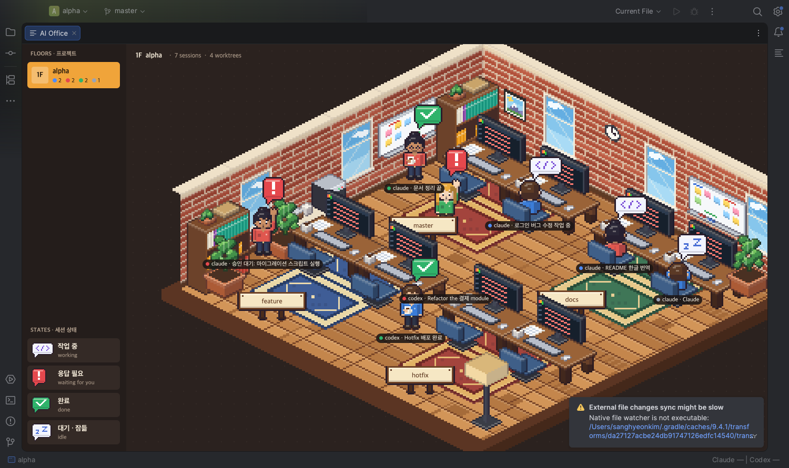
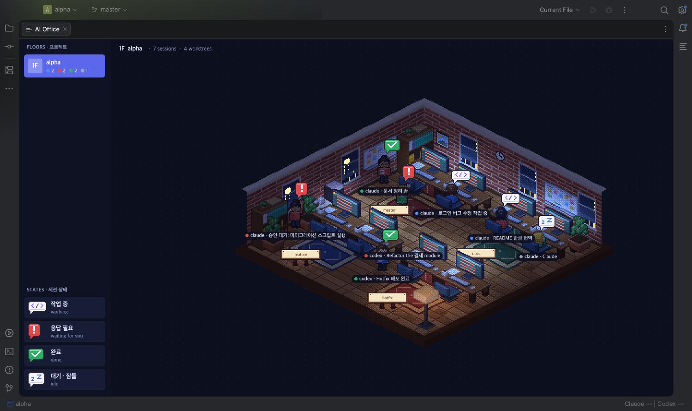

# Phantom AI Visualization

`dev.phantom.ai.visualization` · [English](./README.md)

Phantom AI Integration의 에이전트 세션을 아이소메트릭 픽셀 아트 사무실로 보여 줍니다. Phantom AI Integration 0.3.1 이상(`dev.phantom.ai`)이 필요하며, 그 공개 API `dev.phantom.ai.api`만 씁니다.







- **사무실:** Tools | Open AI Visualization(또는 Find Action의 Open AI Visualization)가 현재 프로젝트의 "AI Visualization" 에디터 탭을 엽니다. 열린 프로젝트마다 한 층, worktree마다 러그와 이름표가 있는 책상 구역 하나, 실행 중인 에이전트 세션마다 책상에 앉은 사람 한 명입니다. 한 worktree에 세션이 여럿이면 그 구역에 사람이 여럿입니다. 실행 중이 아닌 저장된 세션은 그리지 않습니다. 층 선택기는 위층부터 나열하고 상태별 세션 수를 보여 줍니다. 처음 열린 프로젝트가 1F이고, 열 때 현재 프로젝트의 층이 선택됩니다. 한 층에 worktree가 6개를 넘으면 한 쪽에 책상 구역 6개씩 나눕니다.
- **상태:** 작업 중은 책상에서 타이핑하는 사람, 입력 대기는 손을 들고 서 있는 사람과 `!` 말풍선, 완료는 커피를 든 사람과 체크 말풍선, 아직 훅 이벤트가 없는 세션은 자는 사람과 `zzz` 말풍선입니다.
- **서브에이전트:** 세션이 띄운 실행 중인 서브에이전트(Claude의 Task 도구, 에이전트 팀)는 작은 도우미로, 같은 책상 구역에서 그 사람 옆 스툴에 앉아 일합니다. 도우미마다 작은 이름표("Explore", "Plan")가 붙고 그 점은 부모 세션의 상태 색입니다. 세션당 4명까지 그리고 그 이상은 "+N"으로 보이며, 끝난 서브에이전트는 그리지 않습니다. 도우미 위에 마우스를 올리면 이름과 부모 세션 제목이 나오고, 누르면 그 세션의 터미널로 갑니다. 층 수치와 범례는 세션 기준 그대로이고, 사람 툴팁에 도우미 수가 붙습니다.
- **조작:** 사람을 누르면 그 세션의 터미널 탭으로 가고, 빈 책상을 누르면 그 worktree에서 New Claude / New Codex를 고릅니다. Ctrl+휠은 정수 단계(1~6)로 확대·축소하고, 끌면 이동합니다. 사람 위에 마우스를 올리면 제목, 에이전트, 경과 시간이 나옵니다. 애니메이션(타이핑, 말풍선 흔들림)은 탭이 보일 때만 돕니다.
- **표현:** 스프라이트는 2:1 아이소 격자에서 뒤에서 앞으로 깊이순으로, 최근접 정수 배율로 그립니다. 글자는 확대한 뒤 화면 해상도로 또렷하게 그리며 한글도 나옵니다.
- **테마:** 세 가지이며 Settings | Tools | Phantom AI Visualization에서 고릅니다. 열려 있는 AI Visualization 탭은 다시 열지 않아도 바로 바뀝니다.
  - **A, Warm Wood** (기본): 원목 바닥, 벽돌 벽, 아늑하고 어두운 사무실.
  - **B, Modern Bright:** 밝은 회색 타일, 틸 몰딩과 긴 창이 있는 흰 벽, 흰 책상과 틸 의자, 데스크 구역 사이의 틸 반투명 띠가 들어간 유리 파티션, 틸 러그, 밝은 캔버스와 틸 강조색의 층 목록과 범례.
  - **C, Night Shift:** 밤의 테마 A 사무실. 창밖으로 별, 달, 불 켜진 도시 스카이라인이 보이고, 방은 어둡고, 모니터가 차가운 빛을, 스탠드와 커피 머신과 뒤에서 빛나는 이름표가 따뜻한 빛 웅덩이를 디더링된 감쇠로 드리웁니다. 말풍선, 태그, 이름표 글자는 어두워지지 않습니다. 어두운 화면 구성에 인디고 강조색.

  테마는 저마다의 스프라이트 시트와 아틀라스, 팔레트(그리고 선택적으로 조명: 주변광 음영과 프레임에 묶인 광원)이고 한 줄로 등록합니다. 렌더러와 레이아웃은 테마 이름을 모릅니다. 스프라이트는 [art](./art/README.md)의 스크립트로 만듭니다.

## 도구 창 제목줄 액션이 없는 이유

사무실은 Tools 메뉴와 Find Action에서만 엽니다. Phantom AI Integration 도구 창 제목줄에 버튼을 두려면 그 도구 창이 스스로 설정한 제목줄 액션 목록에 더해야 하는데, 플랫폼은 그 목록을 덧붙이지 않고 통째로 바꿉니다. 그러면 다른 플러그인의 버튼이 그 창의 Refresh 액션을 지우게 됩니다.

## 실제 IDE 프로브

프로브는 fixture worktree와 네 상태의 가짜 세션을 둔 실제 IDE를 띄워 사무실을 확인하고 스크린샷을 저장합니다: `ai-office.png`(테마 A), `ai-office-subagents.png`(서브에이전트 도우미가 있는 세션), `ai-office-b.png`와 `ai-office-c.png`(탭을 연 채로 설정에서 테마 B, 이어서 C로 바꾼 뒤. 그다음 A로 되돌립니다), `ai-office-zoom.png`.

```
./gradlew --no-configuration-cache -PrealIde -PprobeScenario=ai-visualization -PprobeOut=<dir> :ai-visualization:runIdeProbe
```

CI와 플러그인 zip에는 들어가지 않습니다. `-PaivizRenderOut=<dir>`를 주면 단위 테스트가 샘플 렌더(A는 `render-zoom3.png`, B는 데스크 구역 3·4·6개의 `render-b-<n>-zoom3.png`)도 그 폴더에 씁니다.
