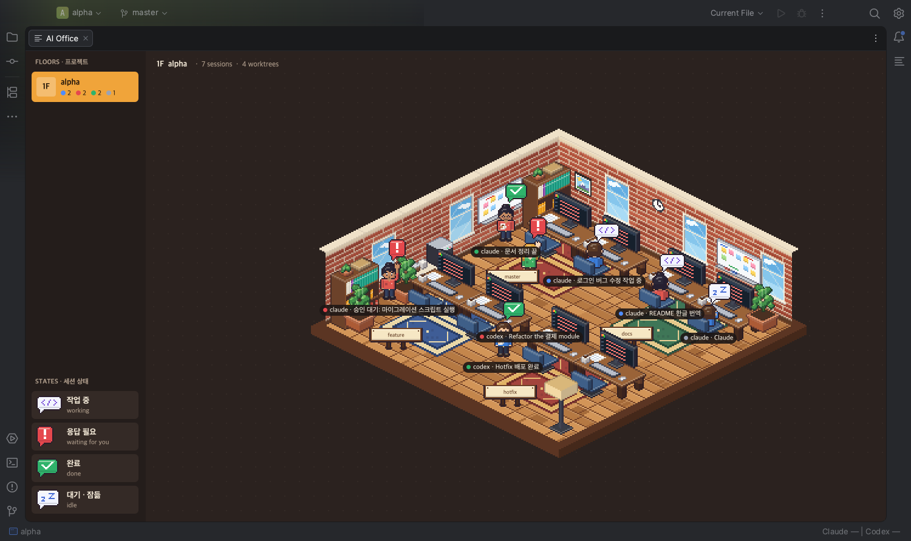
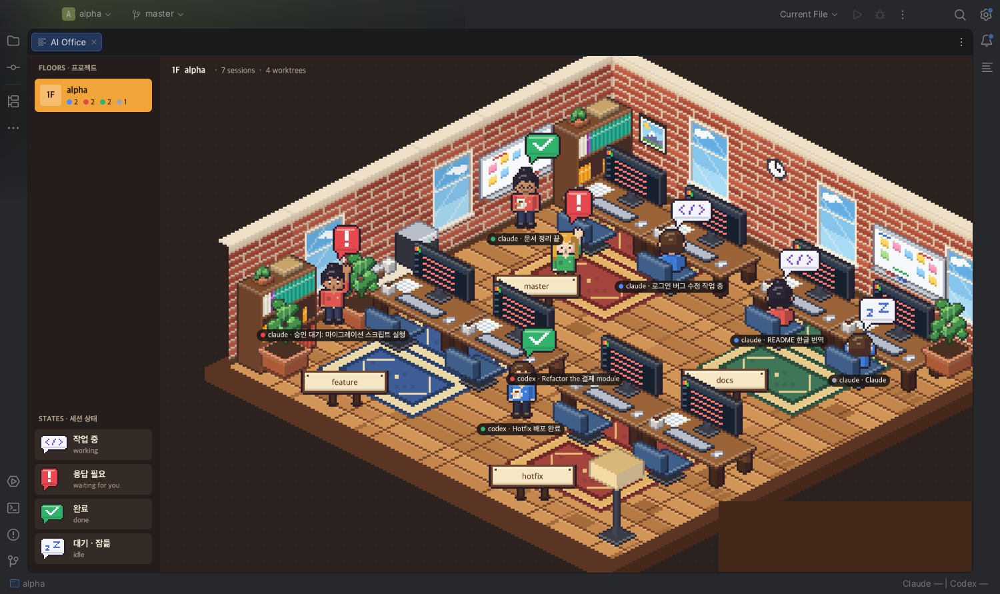
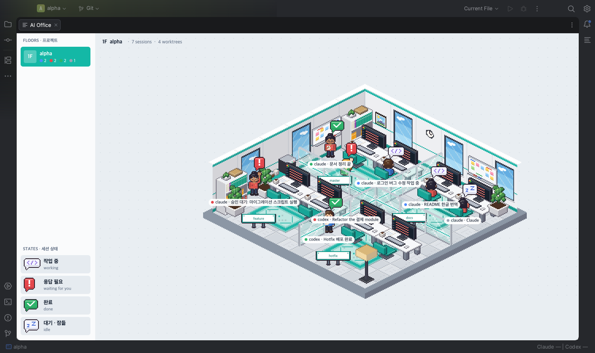
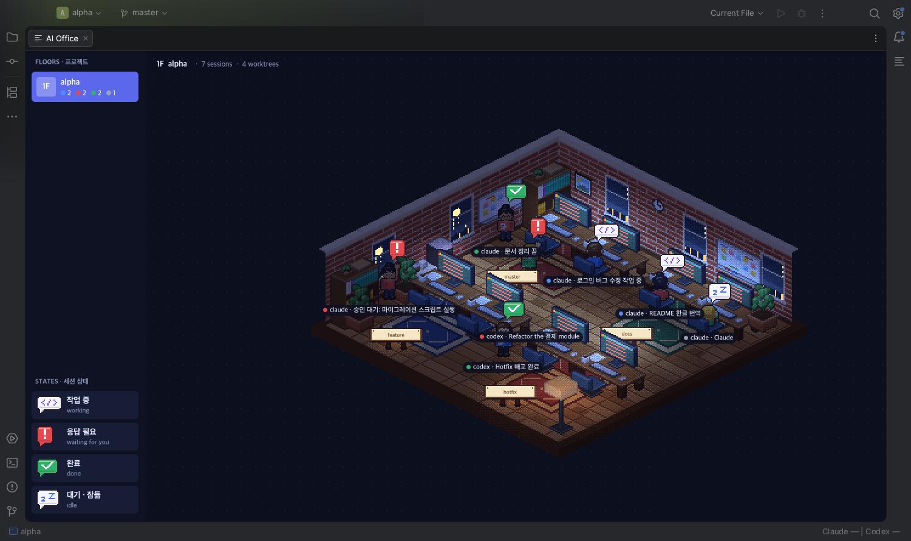
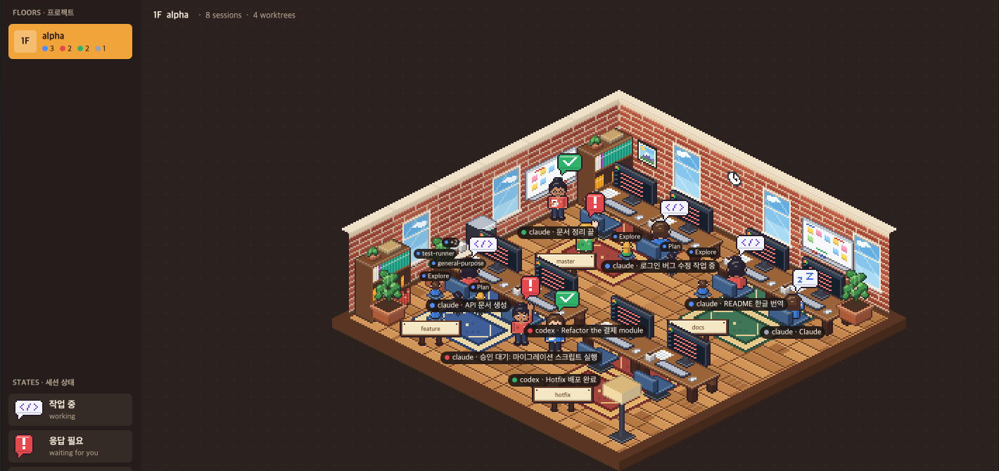

# Phantom AI Visualization

`dev.phantom.ai.visualization` · [한국어](./KOR.md)

The agent sessions of Phantom AI Integration as an isometric pixel-art office. Needs Phantom AI Integration 0.3.1 or later (`dev.phantom.ai`), whose public API `dev.phantom.ai.api` it uses.

Claude is a trademark of Anthropic and Codex a trademark of OpenAI; the names only label the sessions. This plugin is not affiliated with, sponsored or endorsed by Anthropic or OpenAI. The pixel art is drawn by the scripts in [art](./art/README.md); the plugin contains no third-party picture.








- **The office:** Tools | Open AI Visualization (or Open AI Visualization in Find Action) opens an "AI Visualization" editor tab for the current project. Each worktree is a floor of its project (the main worktree is 1F), an office of its own, and each live agent session a person. The first session opened in the worktree is the CEO, alone at one desk in the office marked CEO; every other session that leads running subagents gets a team area of its own (one desk, its subordinates around it, a plate "팀 · <title>"); the rest sit at the open desks (오픈 데스크), which are there even when empty so a new session can be started at one. A session waiting for an answer (a permission request, a question) takes it to the CEO: it lines up in front of the CEO's chair while its desk stays its own, and the CEO's plate counts what waits (CEO · 결재 2); click it to go to its terminal and answer there. Saved sessions that are not running are not drawn. The floor picker lists the floors top-down, with the number of sessions per state; the current project's main floor is selected on open. More than 6 desk areas on a floor are paged.
- **States:** working is a person typing at the desk; waiting for you is a person standing with a raised hand and a `!` bubble; done is a person with a coffee and a check bubble; a session started with no hook event yet is a person asleep with a `zzz` bubble.
- **Subagents:** the running subagents a session started (Claude's Task tool, agent teams) are smaller helpers, each working on a stool beside its person in the same desk area, grouped by role and tagged with it and their name ("리서치 · Explore", "기획 · Plan", "리뷰 · code-reviewer"; else 개발 or 테스트) whose dot has the person's state color. At most 4 per session are drawn, more show as "+N"; stopped subagents are not drawn. Hover a helper for its name and its session's title; click it to focus that session's terminal. Floor counts and the legend stay per session; a person's tooltip adds its helper count.
- **Interactions:** click a person to focus that session's terminal tab; click an empty desk for New Claude / New Codex in that worktree; Ctrl+wheel zooms in whole steps (1 to 6), drag pans; hover a person for title, agent and elapsed time. The animation (typing, bubbles bobbing) runs only while the tab is showing.
- **Look:** sprites are drawn with nearest-neighbour integer scaling on a 2:1 iso grid, depth sorted back to front; all text is drawn after scaling, crisp at screen resolution, and Korean renders.
- **Themes:** three, picked in Settings | Tools | Phantom AI Visualization; open AI Visualization tabs switch at once, without reopening.
  - **A, Warm Wood** (default): wooden floor, brick walls, a cosy dark office.
  - **B, Modern Bright:** light gray tiles, white plaster walls with teal trim and tall windows, white desks and teal chairs, clear glass partitions with a frosted teal band between desk areas, teal rugs, and a light canvas with teal accents in the floor picker and legend.
  - **C, Night Shift:** theme A's office at night. The windows show a starry sky, the moon and a lit city skyline; the room is dark, the monitors cast cool light and the floor lamp, the coffee machine and the backlit name plates warm pools, all with a dithered falloff. Bubbles, tags and plate labels are not dimmed. Dark chrome with an indigo accent.

  A theme is its own sprite sheet with an atlas and a palette (and, optionally, lighting: an ambient shade and light sources tied to frames), registered in one line; the renderer and layout know no theme by name. The sprites are generated by the scripts in [art](./art/README.md).

## Why no tool window title-bar action

The office opens from the Tools menu and Find Action only. A button on the Phantom AI Integration tool window's title bar would have to be added to the list of title actions that tool window sets for itself, and the platform replaces that list instead of appending to it, so another plugin's button would remove its own Refresh action.

## Real-IDE probe

The probe starts a real IDE with fixture worktrees and fake sessions in all four states and checks the office, then saves screenshots: `ai-office.png` (theme A), `ai-office-subagents.png` (sessions with subagents as helpers), `ai-office-b.png` and `ai-office-c.png` (after switching to theme B, then C, through the setting, with the tab left open; then back to A) and `ai-office-zoom.png`:

```
./gradlew --no-configuration-cache -PrealIde -PprobeScenario=ai-visualization -PprobeOut=<dir> :ai-visualization:runIdeProbe
```

It is not part of CI or the plugin zip. `-PaivizRenderOut=<dir>` makes the unit tests also write sample renders (`render-zoom3.png` for A, `render-b-<n>-zoom3.png` for B with 3, 4 and 6 desk areas) there.

**0.6.3**: the plugin description says that Claude and Codex are their owners' trademarks and the plugin is not affiliated with Anthropic or OpenAI. The reference picture and the comparison image that sat next to the art scripts are deleted, and `art/` ignores pictures, so only the scripts and the sprites they generate are kept.
